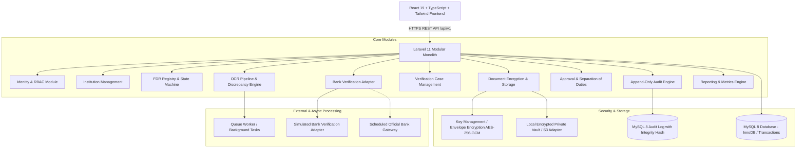

# AICTE FDR Portal — System Architecture Document
## Problem Statement SIH26265

### 1. High-Level Modular Monolith Architecture
The platform is designed as an enterprise-grade modular monolith with decoupled subsystems:

### 2. Core Subsystems

#### 2.1 Identity, RBAC & Multi-Tenant Isolation
- Tenant context is strictly defined at the institution boundary.
- **Roles**:
  - `system_admin`: Platform health, tenant onboarding, system configurations.
  - `aicte_admin`: Regulatory overview, national metrics, queue monitoring.
  - `institution_admin`: Institution user administration, institutional profile.
  - `institution_submitter`: Creates and manages FDR records and uploads supporting documents.
  - `verification_officer`: Case review, document scrutiny, discrepancy resolution, recommendation.
  - `approving_authority`: Final approval or rejection based on evidence. Cannot self-approve own submissions.
  - `auditor`: Read-only access to all submissions, verification trails, and audit logs.
  - `bank_integration`: Machine-to-machine authorized actor for automated verification ingestion.

#### 2.2 Envelope Encryption & Document Vault (AES-256-GCM)
- Every file is assigned a random UUID filename (never user-provided names).
- Each document version generates an ephemeral 256-bit Data Encryption Key (DEK).
- Document plaintext is encrypted with AES-256-GCM generating:
  - Ciphertext
  - 12-byte Nonce (Initialization Vector)
  - 16-byte Authentication Tag (Integrity & Tamper-detection)
- The DEK is encrypted (wrapped) using the master Key Encryption Key (KEK).
- Raw SHA-256 file checksum is preserved for bitwise verification before decryption.
- Downloads stream decrypted bytes in-memory to authorized sessions only; documents are never exposed in public directories.

#### 2.3 OCR Pipeline & Human-in-the-Loop Validation
- Asynchronous extraction job processes uploaded PDFs/images.
- Extracts: Bank name, Branch, FDR No, Principal Amount, Currency, Issue Date, Maturity Date, Lien/Joint holder status.
- Normalized data is scored with an extraction confidence index.
- Human-in-the-Loop: Reviewers can inspect original document side-by-side with extracted values and submit audited corrections.

#### 2.4 Discrepancy & Anomaly Detection Engine
- Runs automated heuristic checks:
  1. Amount mismatch (Submitted vs OCR).
  2. FDR Number mismatch.
  3. Bank mismatch.
  4. Maturity date < Issue date or past date.
  5. Duplicate FDR number across different institutions (Cross-tenant duplicate fraud detection).
  6. Duplicate document SHA-256 hash.
  7. Approaching maturity thresholds (90 days, 30 days).
- Findings are registered with severity levels: `info`, `warning`, `requires_review`, `high_priority`, `verification_blocked`.
- Discrepancy resolution requires human justification and is permanently audited.

#### 2.5 Verification & Approval State Machine
Strict separation of duties:
1. Submitter creates FDR -> `draft` -> `submitted`.
2. System runs OCR and Discrepancy engine -> Verification case generated and assigned to Officer.
3. Officer initiates Bank Verification (Mock/Direct) -> Evidence recorded.
4. Officer reviews checklist, resolves or escalates discrepancies -> Submits `recommended_approval` or `recommended_rejection`.
5. Approving Authority (different user from submitter and officer) renders final verdict: `approved` or `rejected`.
6. Post-approval lifecycle: `maturing`, `renewal_pending`, `renewed`, `release_requested`, `released`, `closed`.

#### 2.6 Append-Only Audit Logging
- Every security and business operation creates an immutable audit event:
  - Event ID, Actor User ID, Actor Role, Institution ID, Action, Resource Type, Resource ID, IP Address, User Agent, State Diff (before/after), Timestamp.
- Audit records cannot be updated or deleted via API.
